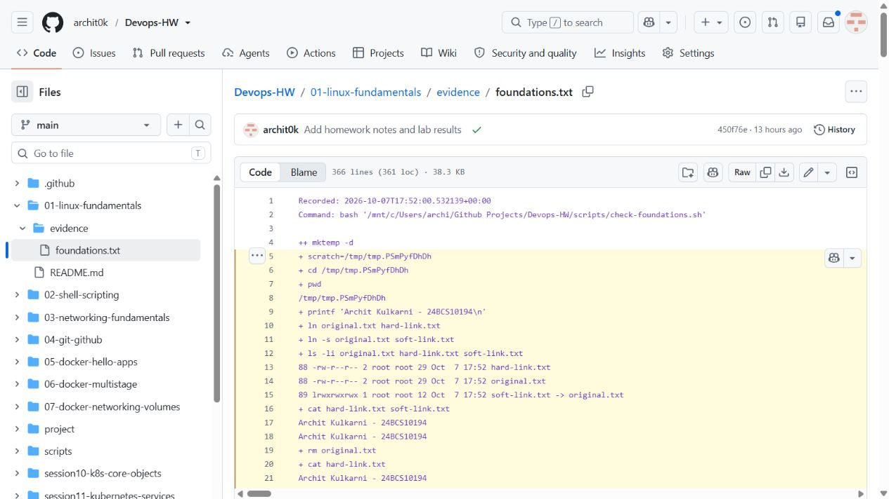

# Sessions 1–2 — Linux fundamentals

Archit Kulkarni | 24BCS10194 | Section A

This exercise covers links, account creation, system logs and common Linux commands. [The execution record](evidence/foundations.txt) contains the command output; the link result is shown below.

## Task 1 - soft links and hard links

A hard link is another directory entry for the same inode and data. A symbolic (soft) link stores a path to its target. Consequently, hard links cannot normally cross filesystems or point to directories, while soft links can; a soft link becomes dangling if the target is deleted.

```bash
mkdir -p link-lab && cd link-lab
echo 'DevOps homework' > original.txt
ln original.txt hard-link.txt
ln -s original.txt soft-link.txt
ls -li original.txt hard-link.txt soft-link.txt
cat hard-link.txt
cat soft-link.txt
rm original.txt
cat hard-link.txt
readlink soft-link.txt
cat soft-link.txt  # fails because original.txt was removed
rm soft-link.txt hard-link.txt
```

After deleting `original.txt`, the hard link still reads the same data. The soft link still stores `original.txt`, but that target no longer exists. `ls -li` also shows the original and hard link sharing an inode, while the soft link has its own inode.

## Task 2 - `adduser` versus `useradd`

`useradd` is the lower-level account command and often needs explicit home-directory, shell and group options. Ubuntu's `adduser` helper asks for account details and sets up a normal interactive account. I used `adduser` for the test account; `useradd` is useful when a script needs exact options.

```bash
sudo adduser devops-test
id devops-test
sudo deluser --remove-home devops-test
```

## Task 3 - `journalctl`

`journalctl` queries the systemd journal, which centralizes kernel, boot, and service logs.

```bash
journalctl -b                    # current boot
journalctl -u ssh --since today  # one service, since today
journalctl -p err                # errors and more severe events
journalctl -f                    # follow new log entries
```

For a service incident, I would first use `journalctl -u <service> -b`, then add a time window such as `--since '30 minutes ago'`.

## Task 4 - essential command cheat sheet

| Purpose | Commands |
| --- | --- |
| Navigate and inspect | `pwd`, `ls -la`, `cd`, `find`, `stat` |
| Files and text | `cp`, `mv`, `rm`, `mkdir`, `touch`, `cat`, `less`, `grep` |
| Permissions | `chmod`, `chown`, `umask` |
| Processes | `ps aux`, `top`, `kill`, `pgrep` |
| Storage | `df -h`, `du -sh`, `mount` |
| Network | `ip addr`, `ss -tulpn`, `ping`, `curl` |
| Archives | `tar -czf archive.tgz folder/`, `tar -xzf archive.tgz` |

Practice each command in a disposable directory and read `man <command>` before using destructive flags.

## Results

[Command output](evidence/foundations.txt) shows equal original/hard-link inode numbers, the dangling soft link, the disposable user-account checks, journal queries and command practice. The test accounts were removed after the exercise.

Screenshot of the saved command output:


