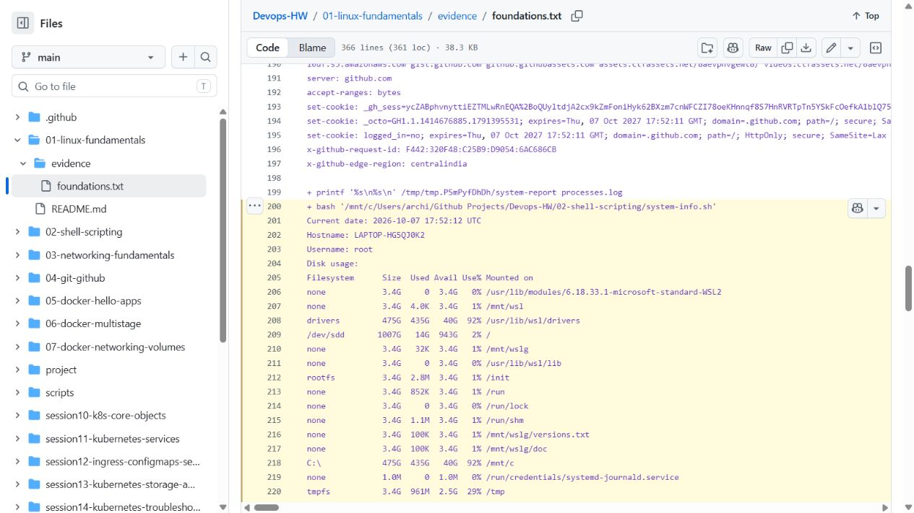

# Session 3 — Shell scripting

Archit Kulkarni | 24BCS10194 | Section A

[system-info.sh](system-info.sh) prints the date, hostname, username, disk usage and processes. It stores values in variables, reads a directory/file name, creates both and redirects `ps aux` to the requested file.

| Requirement | Command used |
| --- | --- |
| Date, hostname and user | `date`, `hostname`, `whoami` |
| Disk and process information | `df -h`, `ps aux` |
| User input | `read -r -p` |
| Directory and file creation | `mkdir -p`, `touch` |
| Save process report | `ps aux > "$target_directory/$process_file"` |

Run from this assignment directory in a Linux shell:

```bash
chmod +x system-info.sh
./system-info.sh
```

Example input:

```text
Enter a directory name to create: system-report
Enter a file name for process output: processes.log
```

`system-report/processes.log` saves the `ps aux` output. Disk usage and processes are also printed in the terminal.

## Verification output (Ubuntu WSL, 2026-09-03)

The script was executed with the example input above. Its captured output began as follows:

```text
Current date: 2026-09-03 18:06:25 UTC
Hostname: LAPTOP-HG5QJ0K2
Username: archit
Disk usage:
Filesystem      Size  Used Avail Use% Mounted on
/dev/sdd       1007G  2.3G  954G   1% /
C:\\             475G  452G   24G  96% /mnt/c
Running processes:
USER         PID %CPU %MEM    VSZ   RSS TTY      STAT START   TIME COMMAND
root           1 21.7  0.2  24316 15360 ?        Ss   18:06   0:01 /sbin/init
...
Process information was saved to: system-report/processes.log
```

The full process report stays in the local `system-report/` directory.

## Results

The 7 October Ubuntu WSL run created the requested directory/file and saved 133 lines of process output. Date, hostname, user, disk and process information were printed. The [execution record](../01-linux-fundamentals/evidence/foundations.txt) includes the script run alongside the Linux/networking exercises.

Screenshot of that saved execution record:


