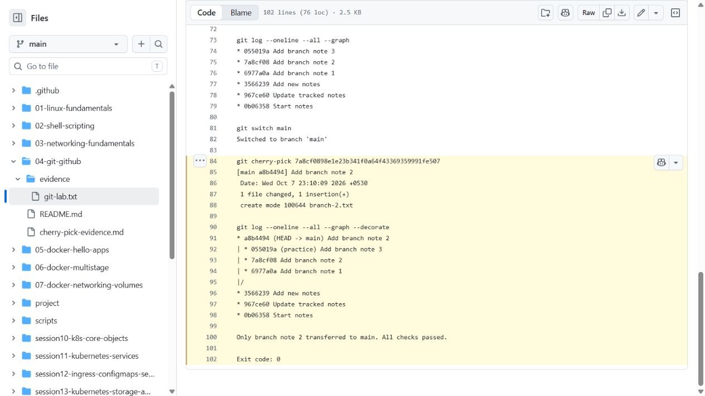

# Session 5 — Git and GitHub

Archit Kulkarni | 24BCS10194 | Section A

Staged commits, automatic staging with `-a`, and cherry-picking a branch commit. [Command output](evidence/git-lab.txt).

## `git commit -a -m` versus `git commit -m`

`git commit -m "message"` commits only changes already staged with `git add`. `git commit -a -m "message"` automatically stages modifications and deletions of **tracked** files, but never adds untracked files. Therefore a new file still needs `git add new-file` first.

```bash
git add tracked-file.md
git commit -m "add file"

# After changing an existing tracked file:
git commit -a -m "update"
```

## Cherry-pick lab

```bash
git log --oneline --all --decorate
git switch -c cherry-pick-lab
# make and commit lab changes
git switch main
git cherry-pick <commit-sha>
git log --oneline --decorate -n 10
```

The `cherry-pick-evidence.md` file is created on the lab branch and then cherry-picked into `main`, demonstrating selective transfer of one commit rather than merging the complete branch.

## Results

In the isolated practice repository, main had three initial commits and the practice branch had three more. Only the second branch commit was cherry-picked; the other two branch-only files were absent from main. The transcript also shows `-m` leaving unstaged changes out and `-am` leaving untracked files out. [The earlier cherry-pick file](cherry-pick-evidence.md) is retained in this repository's history.


