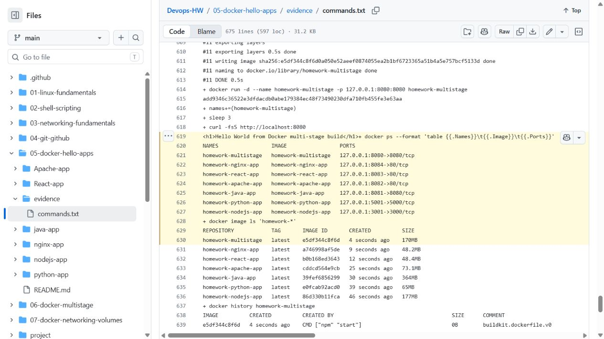

# Session 6 — Docker Hello World applications

Archit Kulkarni | 24BCS10194 | Section A

Each required application has its own source folder and Dockerfile. Run the commands from `05-docker-hello-apps/`; the host ports are different so the containers can run together.

| App | Build/run | URL |
| --- | --- | --- |
| [Node.js](nodejs-app/) | `docker build -t hw-node ./nodejs-app && docker run --rm -p 3001:3000 hw-node` | http://localhost:3001 |
| [Python](python-app/) | `docker build -t hw-python ./python-app && docker run --rm -p 5001:5000 hw-python` | http://localhost:5001 |
| [Java](java-app/) | `docker build -t hw-java ./java-app && docker run --rm -p 8081:8080 hw-java` | http://localhost:8081 |
| [Apache](Apache-app/) | `docker build -t hw-apache ./Apache-app && docker run --rm -p 8082:80 hw-apache` | http://localhost:8082 |
| [React](React-app/) | `docker build -t hw-react ./React-app && docker run --rm -p 8083:80 hw-react` | http://localhost:8083 |
| [Nginx](nginx-app/) | `docker build -t hw-nginx ./nginx-app && docker run --rm -p 8084:80 hw-nginx` | http://localhost:8084 |

Use `curl http://localhost:<port>` to verify the Hello World response after starting each container.

## Results

All six images were built and started on a clean Linux runner. HTTP checks passed for Node.js, Python, Java, Apache, React and Nginx; the React check also downloaded the built JavaScript asset. [Complete command output](evidence/commands.txt) and the [actual run](https://github.com/archit0k/Devops-HW/actions/runs/37658269060) show the builds, responses and cleanup. The same run checked the multi-stage app on port 8080.

