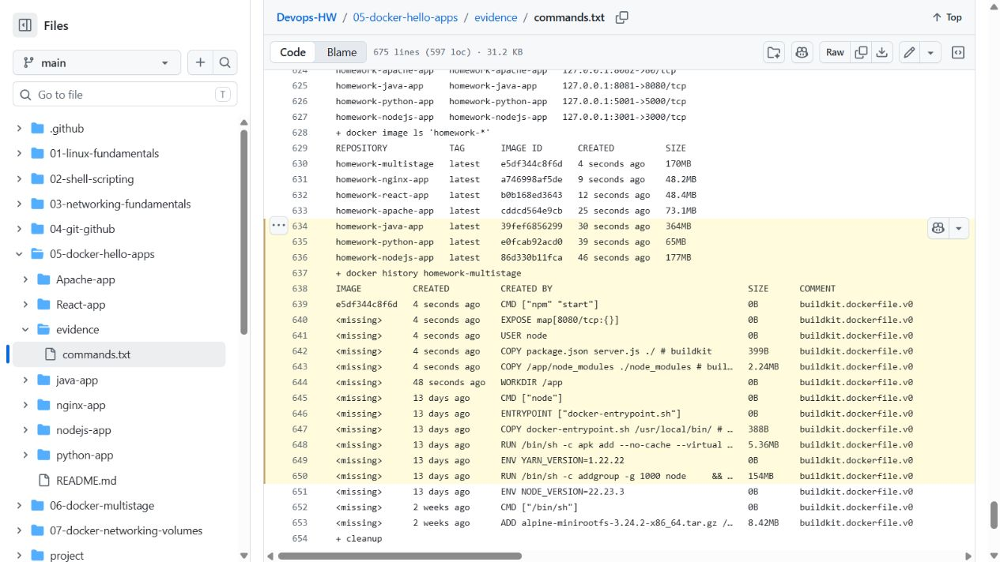

# Session 7 — Docker multi-stage build

Archit Kulkarni | 24BCS10194 | Section A

The [Dockerfile](Dockerfile) installs production dependencies in one stage and copies only `node_modules`, `package.json` and `server.js` into the runtime stage. The application listens on port 8080.

## Build and run

```bash
docker build -t archit-multistage-app .
docker run -d --name archit-multistage -p 8080:8080 archit-multistage-app
docker ps --filter name=archit-multistage
curl http://localhost:8080
```

Application response:

```html
<h1>Hello World from Docker multi-stage build</h1>
```

`docker ps` shows `0.0.0.0:8080->8080/tcp`.

## Three Docker application types

[Session 6](../05-docker-hello-apps/README.md) includes Node.js, Python and Java applications, each with a Dockerfile and build/run command.

## Results

The image built, started with `8080:8080` and passed the HTTP check. [Command output](../05-docker-hello-apps/evidence/commands.txt) includes `docker ps`, `docker history`, the Hello World response and cleanup.


