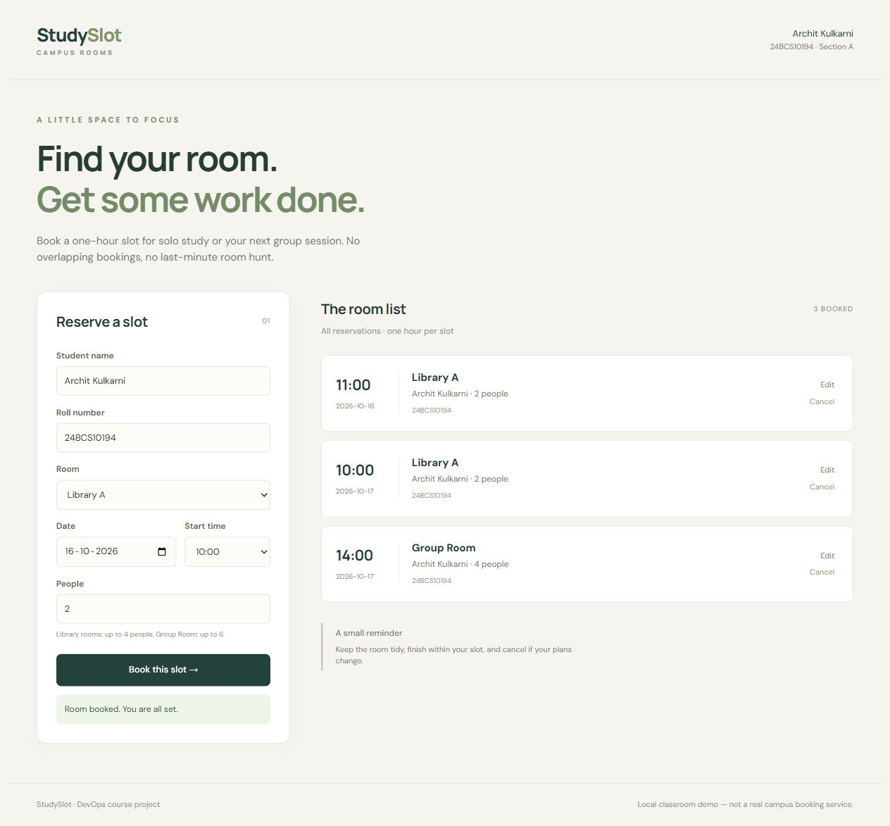

# StudySlot — final DevOps project

Archit Kulkarni · 24BCS10194 · Section A

I picked a study-room booking app instead of copying the TaskBoard example. A student can reserve a one-hour slot, change it, or cancel it. The database prevents two people booking the same room at the same time, including concurrent requests. This is a classroom demo, not an official campus service; it has no login or access control and must not be used with real private bookings.

```text
Browser → Nginx/React → FastAPI → PostgreSQL
                        └→ /metrics → Prometheus → Grafana
GitHub → tests + security gates → SHA-tagged GHCR images → Helm/Kubernetes
Terraform → AWS VPC + EKS       Git → Argo CD reconciliation
```

## Application

`backend/app/` has the API, models and validation. `backend/alembic/versions/001_bookings.py` creates the table. `/health` checks the process; `/ready` checks the database. CRUD routes are `GET/POST /api/bookings` and `GET/PUT/DELETE /api/bookings/{id}`. `/api/rooms` lists room capacities. `/metrics` exposes request counts and latency. Logs contain a request ID, route, status and duration, not submitted student details.

```bash
cd backend
python -m venv .venv
source .venv/bin/activate
pip install -r requirements-dev.txt
alembic upgrade head
pytest -v
uvicorn app.main:app --host 127.0.0.1 --port 8000
```

The development default is SQLite. Compose and Kubernetes use PostgreSQL. Tests override the database with a fresh in-memory SQLite database per test, so a test cannot delete production data.

## Docker

Copy `.env.example` to ignored `.env` and set a local password. Then run `docker compose up --build -d`. Open `http://localhost:3000`. The one-shot migration service finishes before the backend starts. Backend and frontend run as non-root users; the frontend has a Node build stage and an Nginx runtime stage. PostgreSQL stays on the private network and has a named volume.

`docker compose down` preserves the database. Only use `down -v` when intentionally discarding this demo's data.

## Demo and verification

The [demo folder](../demo/README.md) contains the ten-slide presentation and captioned MP4 walkthrough. The [evidence index](evidence/README.md) maps the rubric to actual command records, screenshots and Actions runs. Records keep their timestamps and exit codes; failed attempts are identified, not presented as passing runs. This capstone is separate from the [Session 21 TaskBoard walkthrough](../session21-final-project/README.md).



## Stack and API

Python 3.14, FastAPI, SQLAlchemy, Alembic, PostgreSQL 17, React, Vite, Nginx, Docker Compose, GitHub Actions, Trivy, Terraform, Kubernetes, Helm, Argo CD, Prometheus and Grafana. Python requirements and `frontend/package-lock.json` pin application dependencies.

| Method | Route | Purpose |
| --- | --- | --- |
| GET | `/health`, `/ready` | Liveness and database readiness |
| GET | `/api/rooms` | Room capacities |
| GET, POST | `/api/bookings` | List and create bookings |
| GET, PUT, DELETE | `/api/bookings/{id}` | Read, edit and cancel a booking |
| GET | `/metrics` | Prometheus counters and latency histogram |

Room capacities are four for Library A/B and six for the group room. Input is trimmed, unexpected fields are rejected and the database enforces a unique room/date/hour key. Duplicates return 409, invalid input 422, missing records 404 and deletion 204. `/ready` returns 503 when the database is unavailable. Two migration init containers are serialized with a PostgreSQL advisory lock.

## Tests and security

From `project/backend/`, after installing `requirements-dev.txt`:

```bash
pytest -v
ruff check app tests alembic
bandit -r app -ll
pip-audit -r requirements.txt
```

All 16 API tests passed against an isolated in-memory SQLite database. A separate [HTTP integration script](scripts/check-api.py) verifies real PostgreSQL through Compose, Kind, Minikube and EKS. It performs CRUD and races two POST requests, expecting exactly one 201 and one 409, then removes its own test records. [Recorded checks](evidence/tests-final.txt).

Trivy scans OS packages and application dependencies in both final runtime images. The recorded [backend](evidence/ci-d410e13/scans/backend.txt) and [frontend](evidence/ci-d410e13/scans/frontend.txt) scans found no matching HIGH/CRITICAL advisories against that run's database. This does not rule out lower-severity, undisclosed or application-level problems; either scan returning nonzero blocks image publication. [Security notes](security/README.md) explain the other gates and the exact historical instructor-demo-password fingerprints, which are not real account credentials.

## CI/CD

The [workflow](../.github/workflows/studyslot.yml) runs on every main push. API tests, frontend build and full-history Gitleaks run first. Both Dockerfiles are built and scanned, then the Compose stack is checked. Only after these gates pass are images published as `ghcr.io/archit0k/studyslot-backend:<commit SHA>` and `ghcr.io/archit0k/studyslot-frontend:<commit SHA>`; no `latest` promotion is used.

The exact scanned images are exported as a short-lived artifact and loaded into an isolated Kind cluster. Helm and real HTTP checks verify the deployment. That cluster is removed even if checks fail. The optional EKS job runs after Kind, uses short-lived OIDC credentials and deploys the same SHA. `ENABLE_EKS_CD` is enabled only during the temporary cloud lab and disabled before teardown; normal CI/Kind verification continues without AWS charges.

The [d410e13 pipeline](https://github.com/archit0k/Devops-HW/actions/runs/38892864403) passed all five normal jobs. The [AWS bootstrap](https://github.com/archit0k/Devops-HW/actions/runs/38893003011) passed its EKS deployment, non-root checks, Ingress CRUD, concurrent PostgreSQL checks and migration verification. The evidence index links the final namespace-only deployment and the main push recorded in the video.

## Terraform and AWS

The [Terraform folder](terraform/README.md) creates a `10.42.0.0/16` VPC, public subnets in two availability zones, internet gateway/routes, EKS 1.35 and two `t3.medium` workers in `us-east-1`. EBS CSI, Pod Identity and Metrics Server add-ons support storage and HPA. There is no IAM user, long-lived key, NAT gateway, RDS instance or public application LoadBalancer.

From the repository root, with the temporary `devops-homework` AWS profile configured:

```bash
terraform -chdir=project/terraform init
terraform -chdir=project/terraform validate
bash project/scripts/terraform-lab.sh plan
bash project/scripts/terraform-lab.sh apply
# Dispatch the AWS setup workflow with bootstrap + an already tested SHA.
bash project/scripts/terraform-lab.sh restrict
```

Initial setup temporarily has cluster-admin access on this EKS cluster only. Normal CD uses AWS `eks:DescribeCluster`, EKS Edit access only in `studyslot`, and a namespace Role for ServiceMonitors. OIDC trust requires the exact immutable repository IDs and `main`. Secrets are generated at runtime; state, plans and passwords remain ignored.

Cleanup order: disable `ENABLE_EKS_CD`, dispatch the AWS workflow's `cleanup` action to remove the release/PVC while EBS CSI still runs, then run `bash project/scripts/terraform-lab.sh destroy`. Check for leftover clusters, VPCs, instances and volumes. The budget is $30 maximum; credits are not a reason to leave resources running.

## Kubernetes, Helm and GitOps

The chart under `helm/studyslot/` defines two frontend replicas, a backend HPA (2–4 replicas at 60% CPU), ClusterIP Services, Ingress `/` and `/api`, probes, migration init containers and PostgreSQL on a 2 GiB PVC. `k8s/namespace.yaml` creates the namespace; the database Secret is bootstrapped separately.

For the local lab, allow about 5 GiB RAM and six CPUs while monitoring and Argo CD run together. From the repository root, with the two scanned SHA-tagged images loaded in Docker:

```bash
bash project/scripts/prepare-local.sh ea51f5a57bcb2fd435a33cc64a91730c17b824f3
bash project/scripts/setup-gitops.sh
bash project/scripts/forward-local.sh
# Another shell:
bash project/scripts/verify-local.sh
```

The helper uses matching Minikube kubectl. Port 3000 forwards the actual Ingress controller, not the frontend directly. Backend 8000, Prometheus 9090, Grafana 3001 and Argo CD 8081 bind to loopback. Stop Compose first to avoid port conflicts. Install Helm and the runtime Secret before enabling Argo CD so they do not race to create the initial resources.

Argo CD follows `main`, the chart and `gitops/values-local.yaml`. That file pins the tested `ea51f5a` images. Changing `demoRevision` to `booking-demo` updates a ConfigMap and Pod annotation, causing a real backend rollout. Auto-sync, pruning and self-healing are enabled. Argo ignores backend replica drift because the HPA owns scaling. The recorded Git change reached Synced/Healthy.

## Prometheus and Grafana

`scripts/setup-monitoring.sh` installs the pinned kube-prometheus-stack chart with [these values](monitoring/values.yaml). [dashboard.yaml](monitoring/dashboard.yaml) provisions the StudySlot dashboard. The ServiceMonitor scrapes `/metrics` on backend Pods. Grafana's generated login stays in a runtime Secret, not Git.

The dashboard shows targets UP, request count/rate, backend replicas, CPU, p95 latency and 5xx rate. Example queries:

```promql
sum(up{namespace="studyslot"})
sum(studyslot_http_requests_total{namespace="studyslot"})
histogram_quantile(0.95, sum by (le) (rate(studyslot_http_request_duration_seconds_bucket{namespace="studyslot"}[5m])))
```

The [local verification](evidence/kubernetes-local.txt) confirms successful scrapes and populated queries. [Grafana](evidence/grafana-live.jpg) shows actual data. Inaccessible managed control-plane metrics are disabled explicitly; application scraping remains enabled. Metrics Server supplies HPA CPU readings separately.

## Troubleshooting and limits

An older Compose volume had its original password, so it was preserved and a separate `studyslot-verify` stack was used. Enabling Argo before Helm caused an ownership conflict; existing StudySlot resources were adopted once with `--take-ownership`, then reconciled normally. The local cluster needed more capacity, more tolerant Metrics Server probes and a CoreDNS/controller restart after a DNS timeout. Failed attempt logs are retained beside successful records.

The first cloud role trust used the older name-only GitHub subject; this repo requires immutable IDs. EKS's built-in Edit policy also excluded ServiceMonitors, so a small namespace Role was added without retaining cluster-admin access. On Windows/WSL, the large Terraform provider was moved to Linux storage to avoid startup timeouts; dependency lock verification stays enabled.

This is a disposable classroom system: no authentication, TLS ingress, highly available database or automated backups. The single PostgreSQL PVC survives a Pod restart, not intentional PVC deletion. Ingress Nginx matches the classroom exercise, but was retired in March 2026 and is not a production recommendation. Images need rescanning over time. The walkthrough records a temporary lab, not an always-on AWS endpoint after cleanup.

## Submission

Follow the instructor's [submission guide](https://github.com/Nency-Ravaliya/devsecops-python/blob/main/SUBMISSION.md) and [rubric](https://github.com/Nency-Ravaliya/devsecops-python/blob/main/GRADING.md). The confirmed deadline is **16 October 2026, 11:59 PM IST**. Submit the repository link once in the [capstone form](https://forms.gle/XWAP1vAumDJgAPM1A), using the official SST email. No form has been submitted from this work.
