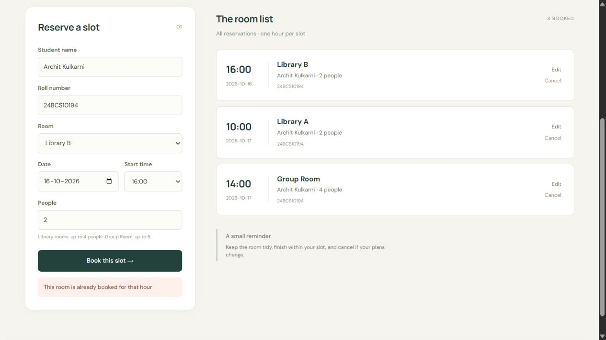
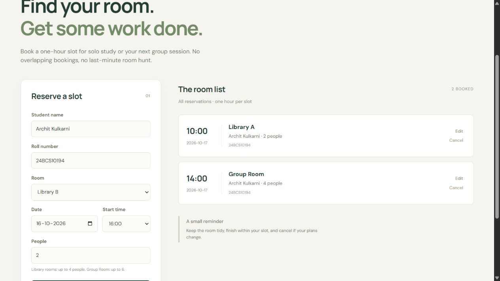
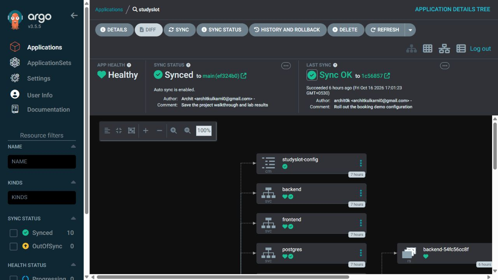
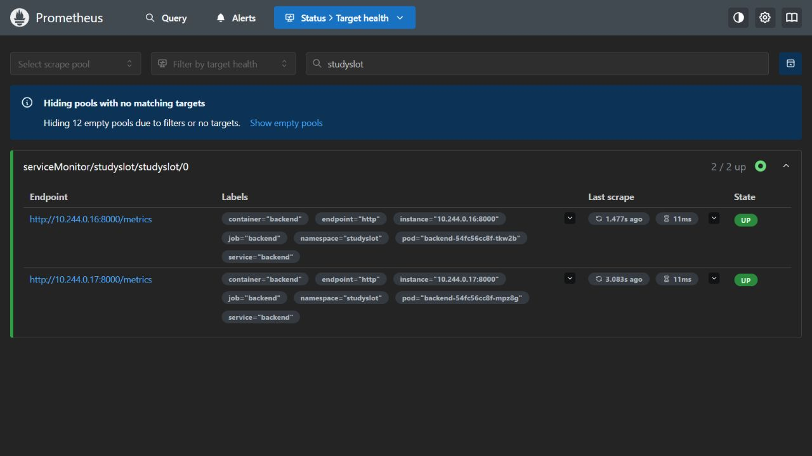
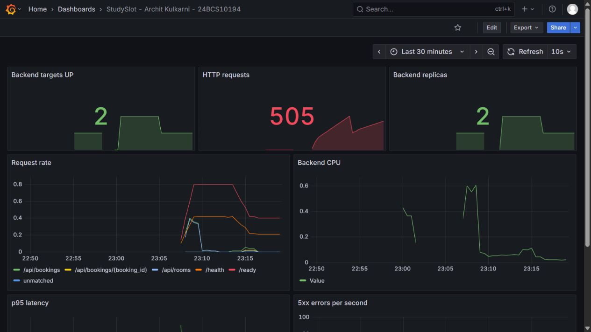
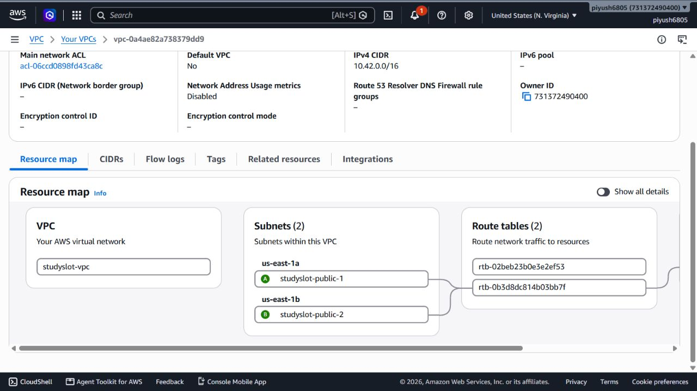
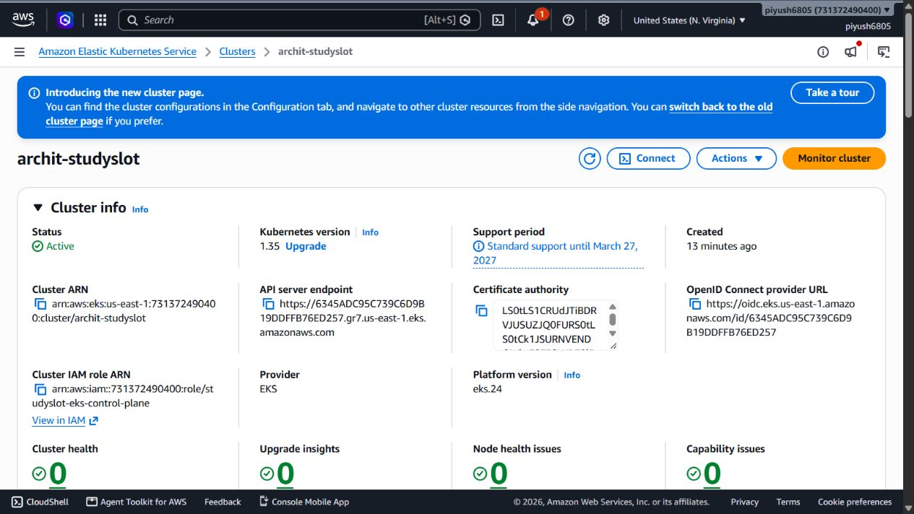

# Recording rehearsal, 16 October 2026

This is a new recording preparation, separate from the earlier completed AWS lab. The original evidence remains dated and unchanged.

## Status

- Recording is paused as of 17 October (IST); command logs use UTC. [Local shutdown](local-stopped.txt) and the [pause verification](local-paused-final.txt) confirm the demo is stopped, with the local PVC and ignored SQL backup preserved. The slideshow server is also stopped. Keep the environments off until the next recording window.
- [Fresh tests and code/dependency checks](tests.txt) passed: 16 tests, Ruff, Bandit and pip-audit.
- [Local end-to-end checks](verify-local-passing.txt) passed: real PostgreSQL CRUD/conflicts, healthy routing, Prometheus scrapes/queries, Argo CD Synced/Healthy and working CPU metrics.
- The first [startup verification](verify-local.txt) caught temporary readiness/metrics problems. It is retained as a failed attempt, not a passing result. Ingress and Metrics Server recovered after restart, and the later verification passed.
- The Grafana replica panel now aggregates its metric so stale/restarted kube-state-metrics series do not produce duplicate stat values.
- [Initial Terraform plan](terraform-plan.txt): 26 intended resources. The [first apply](terraform-apply.txt) created the network, cluster and workers but correctly failed on a GitHub OIDC provider that another project already owned. The provider is now reused without importing or modifying it. The [repair plan](terraform-access-plan.txt) adds only four missing StudySlot access resources; [its apply](terraform-access-apply.txt) is recorded separately. The resulting lab manages 25 resources, VPC `vpc-0a4ae82a738379dd9`. This rehearsal's cleanup is not proven by the earlier lab's cleanup file.
- The [fresh AWS bootstrap](https://github.com/archit0k/Devops-HW/actions/runs/38942882934) passed. [Access restriction](terraform-restrict.txt) then replaced cluster administration with deployment permissions only in the `studyslot` namespace. The [push pipeline](https://github.com/archit0k/Devops-HW/actions/runs/38943691357) passed all six jobs, including AWS deployment, before the pause.
- Cloud and local shutdown are complete. [Cloud CD is disabled](cloud-cd-disabled.txt), the [cleanup workflow](https://github.com/archit0k/Devops-HW/actions/runs/38946391044) removed the application and PVC, and [Terraform destroyed all 25 managed resources](terraform-destroy.txt). [Read-only checks](cloud-cleanup.txt) passed: no StudySlot cluster, VPC, active workers, recorded volumes, temporary IAM roles or Terraform state entries remain. Shared/unrelated resources were left untouched.
- A new personally narrated live video has not yet replaced the earlier captioned MP4. Follow the [recording guide](../../../demo/recording-guide.md) and [speaking script](../../../demo/speaking-script.md).

## Shutdown records

The [target ledger capture](cleanup-targets-final.txt) recorded this lab's exact VPC, three disk IDs and four IAM roles before deletion. The [worker-volume check](worker-volumes-after-delete.txt) and [final cleanup check](cloud-cleanup.txt) confirm those disks are gone. The pre-existing shared GitHub OIDC provider was not owned by this Terraform state and was not deleted.

The successful [Kubernetes cleanup record](aws-cleanup-workflow.txt) is linked above. A [duplicate cleanup dispatch](https://github.com/archit0k/Devops-HW/actions/runs/38946391990) overlapped and failed with `release: not found`; the successful run completed PVC deletion. Neither run was hidden or rewritten.

The local database, SQL backup, screenshots, slide deck and source files are retained. Temporary cloud demo data was deliberately removed with its PVC. AWS usage incurred before deletion may appear in billing later; this check is scoped to this lab, not a claim that the entire shared AWS account is empty.

## Fresh browser captures

These are browser screenshots of the actual running services, not mockups. The rehearsal booking used Archit's own synthetic details and was cancelled after checking the duplicate-slot response.

### Application and conflict handling

### GitOps

### Monitoring

### New AWS VPC

## Recording material

Use the current slide deck and command guide for the new recording. Keep the microphone audible, commands readable and all login/Secret/state content off camera. Record the actual push and its matching pipeline. No form is submitted automatically.
