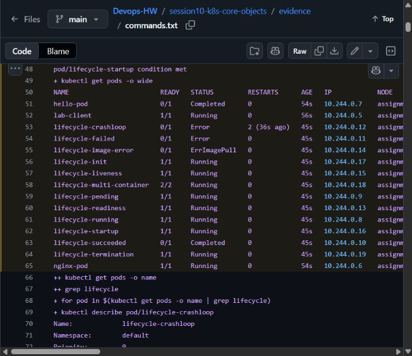
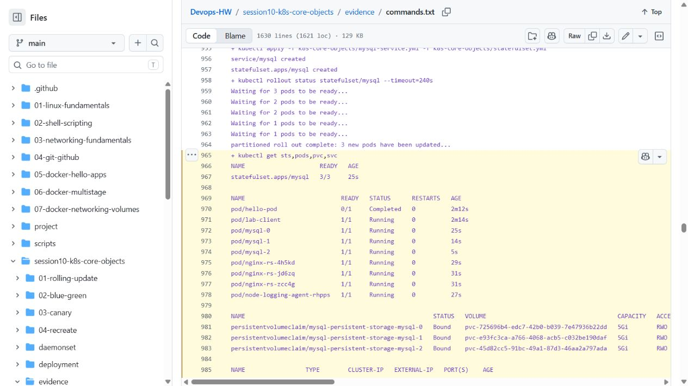

# Session 10 — Pods, controllers and deployment strategies

Archit Kulkarni | 24BCS10194 | Section A

The manifests are grouped into Pod lifecycle, controllers and four deployment strategies. The [execution record](evidence/commands.txt) contains the apply/get/describe/log checks and results. Run commands from this assignment directory and clean up each scenario afterward.

## Pod and lifecycle work

- `pod.yml`: standalone Nginx Pod. Validate with `kubectl get pod nginx-pod -o wide`, `kubectl logs nginx-pod`, then delete it.
- `hello.yml`: short BusyBox job with `restartPolicy: Never`; watch it move from creation to completion.
- `pod-lifecycle/`: running, pending, succeeded, failed, crash-loop, image-pull, readiness, liveness, startup, init-container, multi-container, and termination cases.

```bash
kubectl apply -f pod.yml
kubectl get pods -o wide
kubectl logs nginx-pod
kubectl delete -f pod.yml

kubectl get pods -w
kubectl apply -f hello.yml
kubectl logs hello-pod
kubectl delete -f hello.yml
```

An `ImagePullBackOff` creates an API object successfully because the API server persists the desired Pod specification first. The later image pull is a node-runtime operation; kubelet records the pull failure and retries with exponential backoff.

### Recorded observations

The Nginx Pod reached `1/1 Running` on the Minikube control-plane node:

```text
NAME        READY   STATUS    RESTARTS   IP           NODE
nginx-pod   1/1     Running   0          10.244.0.3   minikube
```


The short-lived `hello-pod` later completed and logged `Hello Kubernetes`. The intentionally invalid image produced a pull failure:

```text
NAME                    READY   STATUS         RESTARTS
lifecycle-image-error   0/1     ErrImagePull   0

Failed to pull image "jakwehrgkaejw:kahsdfgkhj": pull access denied,
repository does not exist or may require authorization
Error: ImagePullBackOff
```


### Lifecycle cases

Results from applying all twelve lifecycle files:

| File in `pod-lifecycle/` | Observed behavior |
| --- | --- |
| `01-running.yaml` | Ready, Running |
| `02-pending.yaml` | ContainerCreating → Running |
| `03-succeeded.yaml` | Completed, phase Succeeded |
| `04-failed.yaml` | Error, phase Failed, no restart |
| `05-crashloopbackoff.yaml` | Repeated exit code 1, two restarts at the recorded check and BackOff events |
| `06-imagepullbackoff.yaml` | ErrImagePull/ImagePullBackOff for the invalid image |
| `07-readiness.yaml` | Became 1/1 Ready after its readiness check |
| `08-liveness.yaml` | Running with a passing liveness check at the recorded sample |
| `09-startup.yaml` | Startup check passed and Pod became Ready |
| `10-init-container.yaml` | Init:0/1 during initialization, then main container Running |
| `11-multi-container.yaml` | Both containers Running, 2/2 Ready |
| `12-termination.yaml` | Running before deletion; termination handling recorded during cleanup |

[Session 14](../session14-kubernetes-troubleshooting/README.md) includes a Pending Pod caused by an impossible memory request.



## Controllers and self-healing

`replicaset.yml` maintains the requested stateless replica count and replaces a deleted Pod. `k8s-core-objects/statefulset.yml` demonstrates stable ordinal identities and claims. `daemonset/node-agent-ds.yaml` schedules one host-agent Pod per eligible node.

```bash
kubectl apply -f replicaset.yml
kubectl get rs,pods -l app=nginx
kubectl apply -f k8s-core-objects/statefulset.yml
kubectl get sts,pods,pvc
kubectl apply -f daemonset/node-agent-ds.yaml
kubectl get ds,pods -o wide
```

## Deployment strategies and troubleshooting

| Strategy | Files | What was checked |
| --- | --- | --- |
| Rolling update | [01-rolling-update/](01-rolling-update/) | v1 → v2, rollout status/history, then rollback |
| Blue-green | [02-blue-green/](02-blue-green/) | HTTP response before and after switching the Service selector |
| Canary | [03-canary/](03-canary/) | Nine stable/one canary, request samples, then five of each |
| Recreate | [04-recreate/](04-recreate/) | Old Pods terminated before the new version started |

`01-rolling-update/` uses `maxSurge: 1` and `maxUnavailable: 0`; `02-blue-green/` switches a Service selector between complete blue and green environments; `03-canary/` shares one Service across stable and canary replicas; `04-recreate/` deliberately terminates v1 before creating v2. The `troubleshooting/` manifests reproduce invalid image and selector mismatch failures.

```bash
kubectl apply -f 01-rolling-update/deployment-v1.yaml -f 01-rolling-update/service.yaml
kubectl apply -f 01-rolling-update/deployment-v2.yaml
kubectl rollout status deployment/app-rolling
kubectl rollout undo deployment/app-rolling
```

## Concepts used in this lab

`containerPort` describes an application port in a Pod; Service `targetPort` is the backend port; Service `port` is the virtual in-cluster port; `nodePort` is the externally reachable high port on every node. Labels are object metadata; selectors are matching queries used by Services and controllers.

For a three-replica Deployment, `maxSurge: 1` permits a fourth Pod during the update, while `maxUnavailable: 0` keeps all three requested endpoints available. Requests reserve scheduler capacity; limits cap runtime consumption. Memory units are binary for `Mi`/`Gi` and decimal for `M`/`G`.

## Results

The [command record](evidence/commands.txt) covers all twelve lifecycle cases, completed-job logs, shutdown handling, ReplicaSet replacement, DaemonSet placement, MySQL StatefulSet/PVCs, and all four deployment strategies. The [Linux runner](https://github.com/archit0k/Devops-HW/actions/runs/37658242308) used a real disposable Kubernetes cluster.

Rolling update and rollback passed. Blue-green HTTP checks passed before and after switching the Service selector. Canary started with nine stable and one canary Pod, sampled sixty requests, then scaled to five each. Replica ratios provide an approximate traffic split. Recreate showed the old Pods terminating before the new version started.


