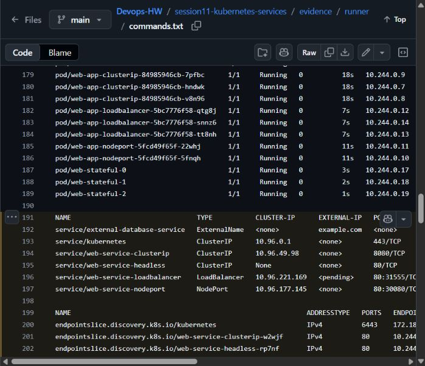

# Session 11 — Kubernetes Services and DNS

Archit Kulkarni | 24BCS10194 | Section A

The manifests cover ClusterIP, NodePort, LoadBalancer, ExternalName, Headless Services, manual endpoints, and DNS checks.

| Service | Main use |
| --- | --- |
| [ClusterIP](01-clusterip/) | Default private service for Pod-to-Pod traffic |
| [NodePort](02-nodeport/) | Development or bare-metal access through a node port |
| [LoadBalancer](03-loadbalancer/) | External access through a supported load-balancer implementation |
| [ExternalName](04-externalname/) | DNS CNAME alias for an external FQDN |
| [Headless](05-headless/) | Direct Pod DNS records for stateful clients |

```bash
kubectl apply -f 01-clusterip/
kubectl get svc,endpoints
kubectl apply -f 02-nodeport/
minikube service web-service-nodeport --url
kubectl apply -f 05-headless/
kubectl exec -it headless-dns-client -- nslookup web-service-headless
```

A normal Service selects matching labels and Kubernetes writes EndpointSlices automatically. A selector-less Service has no automatic backend discovery; its Endpoint/EndpointSlice must be maintained manually. A StatefulSet gives stable names such as `db-0`, whereas Deployment Pods are replaceable and get new generated names.

Useful DNS format: `<service>.<namespace>.svc.cluster.local`. On local Minikube with the Docker driver, `minikube tunnel` is needed for a reachable LoadBalancer address; NodePort access can use `minikube service ... --url`.

## Object comparisons

| Object | Pod management and scaling | Updates | Networking/storage | Example |
| --- | --- | --- | --- | --- |
| Deployment | Owns ReplicaSets and a desired replica count | Creates a new ReplicaSet for rolling updates; supports rollback | Replaceable Pod names; normally exposed through a Service | Stateless web API |
| ReplicaSet | Keeps the requested number of matching Pods alive | Does not itself provide Deployment-style rollout history | No stable client address; use a Service | Replica-count controller below a Deployment |
| DaemonSet | One Pod per eligible node; changes as nodes join/leave | Can roll out an updated node-agent template | Often uses node-local resources | Log collector or node agent |
| StatefulSet | Ordered, stable Pod identities with explicit replica count | Ordered update behavior by default | Per-Pod PVCs and stable DNS through a headless Service | Database replicas |
| Service | Does not create or scale Pods | Routes to currently selected endpoints | Stable virtual address/port, or DNS-only behavior for ExternalName/headless cases | Frontend → backend Pods |

A Deployment manages a ReplicaSet rather than replacing its function. Changing its Pod template creates a new ReplicaSet and lets the Deployment coordinate old/new replicas. A standalone ReplicaSet only maintains its matching Pods.

A ReplicaSet keeps Pods available, but their IPs can change. A Service selects ready matching Pods through EndpointSlices, so clients use a stable Service name instead of tracking replacement Pod addresses.

## DNS

[FQDN notes](fqdn/README.md) explain Service/namespace/domain names and Pod-to-Service lookups. [CoreDNS notes](coredns/README.md) cover the cluster DNS configuration, upstream resolution and troubleshooting commands.

## Results

The [successful Service/DNS run](https://github.com/archit0k/Devops-HW/actions/runs/37664009319) checks ClusterIP HTTP, NodePort HTTP through the real node IP, LoadBalancer internal HTTP, ExternalName CNAME resolution, headless Pod records, EndpointSlices and CoreDNS configuration. [Full output](evidence/runner/commands.txt) is saved beside the manifests.

ExternalName points to `example.com` and returns a CNAME. [FQDN](fqdn/README.md) and [CoreDNS](coredns/README.md) notes explain the lookup paths.

External LoadBalancer access passed on Minikube with `minikube tunnel`: external IP `127.0.0.1`, two ready Pods and an Nginx HTTP response. [Tunnel output](evidence/loadbalancer-tunnel.txt) includes cleanup.


