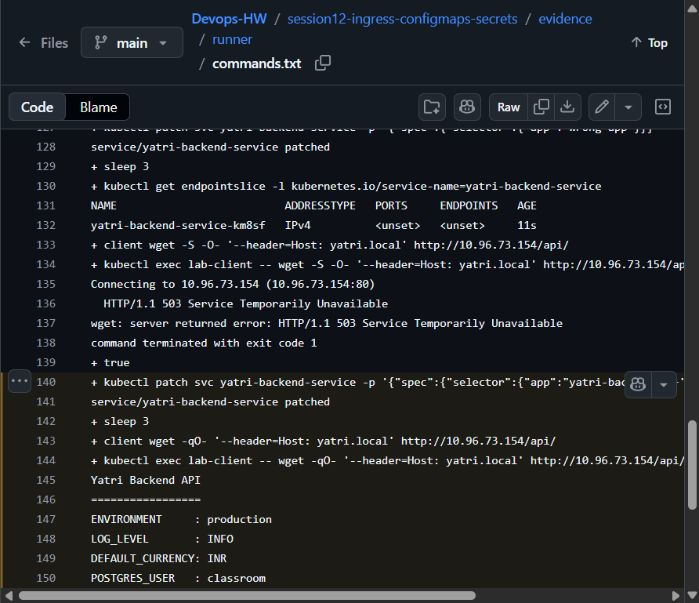
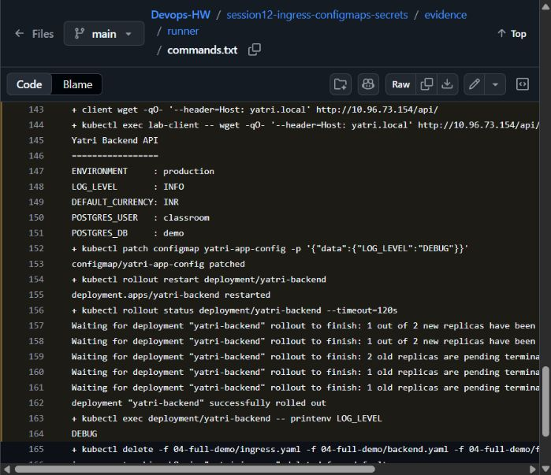

# Session 12 — ConfigMaps, Secrets and Ingress

Archit Kulkarni | 24BCS10194 | Section A

| Task | Files and checks |
| --- | --- |
| ConfigMap | [01-configmap/](01-configmap/): create configuration and verify injected values |
| Secret | [02-secret/](02-secret/): generate a runtime Secret and check injection without publishing the password |
| Ingress | [03-ingress/](03-ingress/) and [04-full-demo/](04-full-demo/): route `/` and `/api/` through the controller |
| Troubleshooting | Break the backend selector, inspect endpoints, correct it and repeat HTTP checks |

## Configuration and secrets

`01-configmap/app-config.yaml` holds non-sensitive values. The Secret YAML files are empty templates; `02-secret/create-secret.sh` creates disposable lab values without saving the password to Git. Kubernetes stores the resulting `data` as Base64. Base64 is encoding, not encryption; RBAC, encryption at rest and an external secret manager protect access in production.

```bash
kubectl apply -f 01-configmap/app-config.yaml
kubectl get configmap
bash 02-secret/create-secret.sh
kubectl get secret
kubectl exec deploy/yatri-backend -- sh -c 'test -n "$POSTGRES_PASSWORD" && echo "password injected (not printed)"'
```

Use `echo -n` before `base64`; plain `echo` appends a newline and changes the decoded password. Updating a ConfigMap does not restart Pods that read it through environment variables, so a rollout restart is needed for those Pods to receive new values.

## Ingress

An Ingress is routing configuration; an Ingress controller is the running software that reads it and handles requests. The rule alone does not listen for traffic. For example, this lab's Nginx controller uses the `/api` rule to select the backend Service; another controller would need a matching IngressClass and its own installation. Enable the classroom NGINX controller before applying `03-ingress/` or `04-full-demo/`.

```bash
minikube addons enable ingress
kubectl get pods -n ingress-nginx
kubectl apply -f 04-full-demo/configmap.yaml
bash 02-secret/create-secret.sh
kubectl apply -f 04-full-demo/backend.yaml -f 04-full-demo/frontend.yaml
kubectl apply -f 04-full-demo/ingress.yaml
kubectl get ingress
```

The full demo routes `/api` to the backend and `/` to the frontend. The `ingress-tls.yaml` example binds a TLS Secret so the controller can terminate HTTPS before forwarding traffic to ClusterIP services.

### Local observation

The ConfigMap and Secret were applied and listed successfully in the local cluster:

```text
NAME                         DATA   AGE
configmap/yatri-app-config   5      2s

NAME                     TYPE     DATA   AGE
secret/yatri-db-secret   Opaque   3      2s
```


## Secret-management flow

```text
Vault / cloud secret manager -> External Secrets Operator -> Kubernetes Secret -> Pod env or volume
```

The external manager remains the source of truth. The operator synchronizes short-lived Kubernetes Secrets, and workloads consume only the keys they need.

## Results and troubleshooting

The [successful run](https://github.com/archit0k/Devops-HW/actions/runs/37664018450) installed the real NGINX Ingress controller, injected configuration and a disposable Secret, waited for routes to load, then checked `/` and `/api/` using `Host: yatri.local`. It deliberately broke the backend Service selector, observed the unavailable backend, fixed it and retested HTTP. Finally it changed `LOG_LEVEL`, restarted the backend and read `DEBUG` from its environment. [Full command output](evidence/runner/commands.txt) includes the checks and cleanup; passwords were not printed.

The selector problem left the backend Service without matching endpoints. Checking Pod labels and the Service selector identified the cause; restoring the selector made `/api/` respond again. Ingress Nginx is retained for the course exercise, not as a recommendation for a new production installation.




