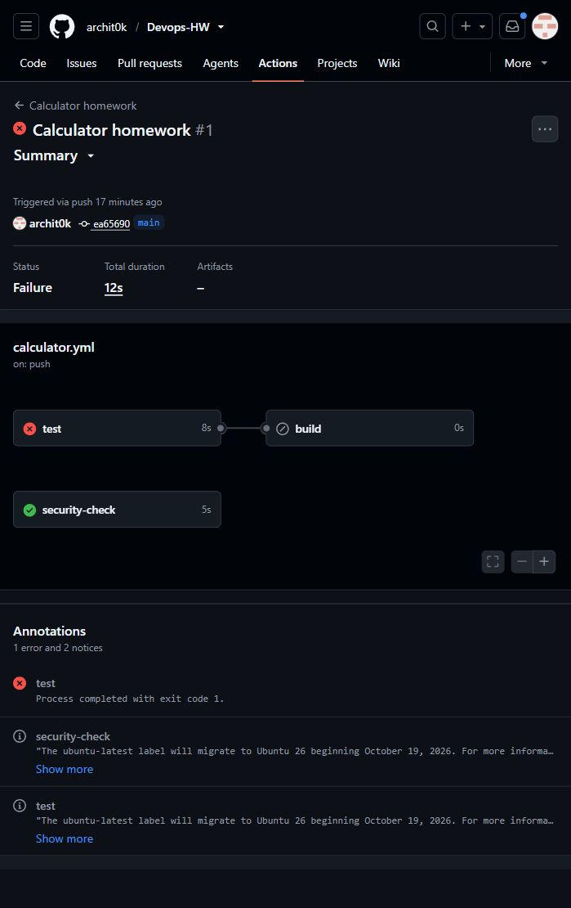
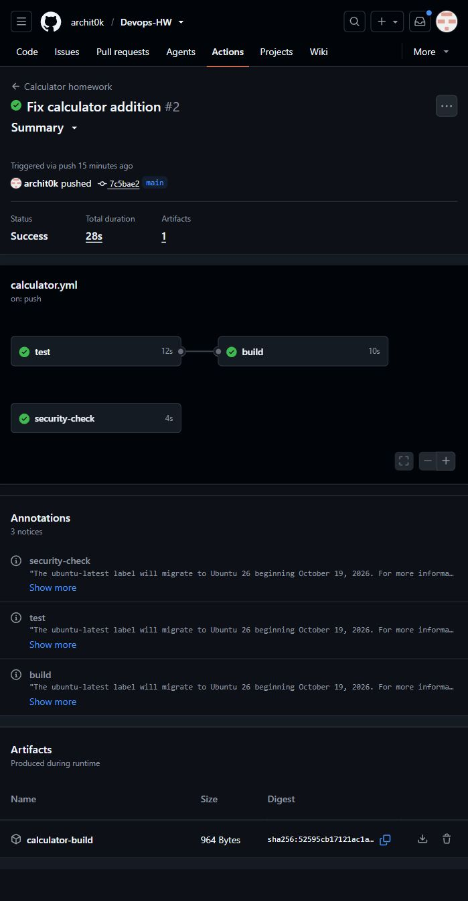

# Session 16 — GitHub Actions

Archit Kulkarni | 24BCS10194 | Section A

[app/calculator.py](app/calculator.py) supports addition, subtraction, multiplication and division, including divide-by-zero handling. There are five [pytest cases](tests/). [build.sh](build.sh) packages the module, and the [Dockerfile](Dockerfile) runs the examples as a non-root user.

## Workflow

The [calculator workflow](../.github/workflows/calculator.yml) runs on relevant pushes to `main` or manual dispatch. `test`, `build` and `security-check` are separate jobs. `build` uses `needs: test`, so a failed test prevents packaging. It checks the Docker image and uploads `calculator-build`, containing the module and a build-info file. This exercise delivers an artifact; the Kubernetes deployment pipeline is in Session 17.

1. The deliberate `a + b + 1` bug produced `assert 16 == 15`: [failed run](https://github.com/archit0k/Devops-HW/actions/runs/37655884909). Four tests passed, one failed, and build was skipped.
2. Addition was corrected to `a + b`: [successful run](https://github.com/archit0k/Devops-HW/actions/runs/37656804648). All five tests passed, all jobs passed, and `calculator-build` was uploaded.





The downloaded [build artifact](evidence/build-artifact/build-info.txt) is also kept with the evidence.

Run these commands from `session16-github-actions/`:

```bash
pip install pytest==9.1.1
pytest -v
bash build.sh
docker build -t calculator-homework .
docker run --rm calculator-homework
```

## Concepts used

CI builds/tests changes; continuous delivery packages a passing version for release, while continuous deployment additionally sends it to a running environment. An event triggers a workflow; jobs run on runners, and steps within each job run in order. `needs` establishes dependencies and artifacts transfer outputs. `${{ secrets.NAME }}` reads a repository secret; `${{ github.sha }}` identifies the source commit. This lab needs no personal access key.

`security-check` checks for credential files. [Session 17](../session17-devsecops/README.md) adds SAST, dependency and image scans.
