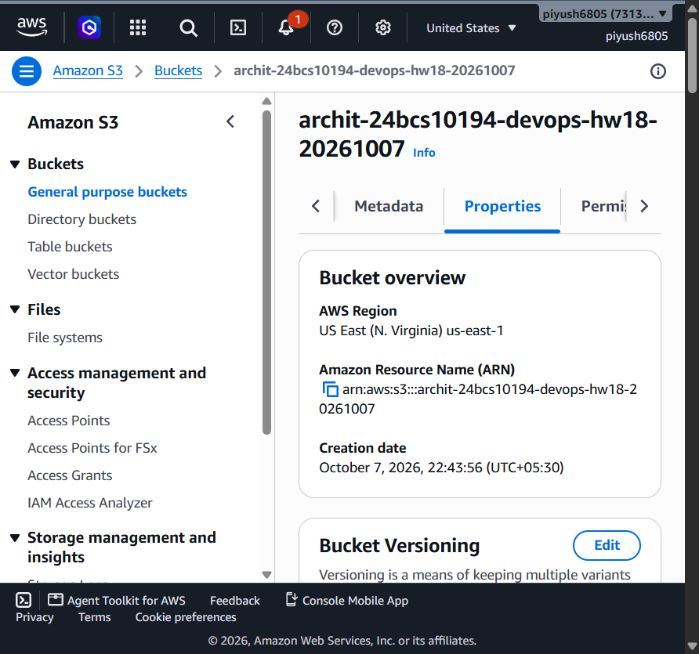

# Terraform S3 demo

Archit Kulkarni | 24BCS10194 | Section A

[Back to Session 18](../README.md)

This configuration creates an S3 bucket, blocks public access and enables SSE-S3 (`AES256`) encryption. The bucket name and Region are inputs; outputs return its name, ARN and Region.

| File | Purpose |
| --- | --- |
| [main.tf](main.tf) | Bucket, public-access block and encryption |
| [variables.tf](variables.tf) | Inputs |
| [outputs.tf](outputs.tf) | Name, ARN and Region |
| [provider.tf](provider.tf) | AWS provider configuration |
| [terraform.tfvars](terraform.tfvars) | Non-secret assignment values |

## Commands

Run inside this directory with an authorized AWS profile:

```bash
terraform init
terraform fmt -check
terraform validate
terraform plan -out=lab.tfplan
terraform apply lab.tfplan
terraform show
terraform output
terraform destroy
```

`init` installs providers, `validate` checks the configuration, `plan` previews changes and `apply` creates them. State links configuration addresses to real resource IDs; the public-access/encryption resources reference the bucket, which establishes dependencies.

## Results

The 7 October run created `archit-24bcs10194-devops-hw18-20261007` in `us-east-1`. [Apply](../evidence/apply.txt), [inspection](../evidence/show.txt) and [outputs](../evidence/output.txt) record the operations. `bucket_arn` was `arn:aws:s3:::archit-24bcs10194-devops-hw18-20261007`.



[Cleanup](../evidence/destroy.txt) completed with `Resources: 3 destroyed` and exit code 0. Use a globally unique bucket name when rerunning. Credentials, state and plans stay local.
