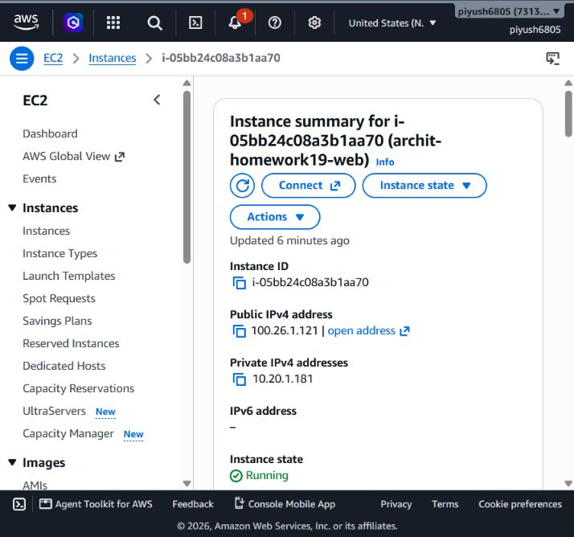
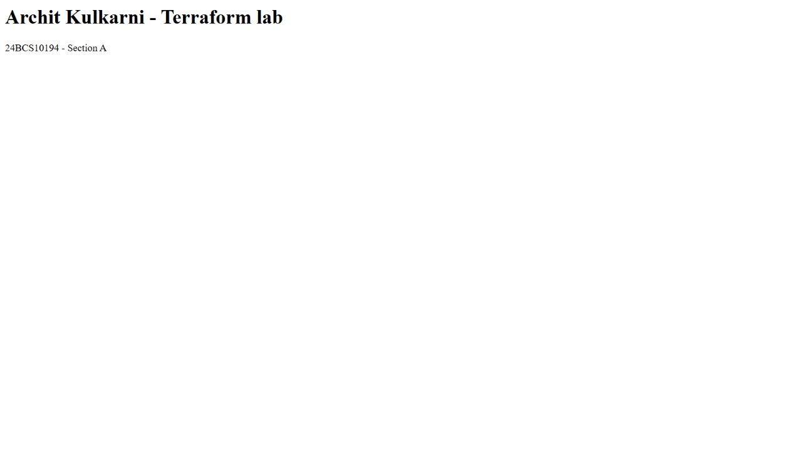
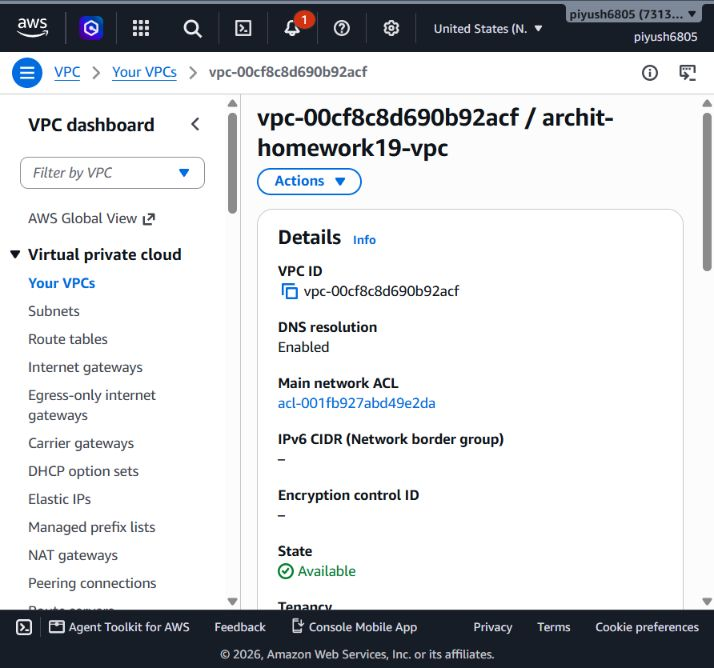

# Session 19 — Cloud and Terraform

Archit Kulkarni | 24BCS10194 | Section A

VPC, public subnet, EC2 web server and private S3 bucket, managed with Terraform.

```text
Internet -> Internet Gateway -> public route table
                                  |
                         subnet 10.20.1.0/24
                         in VPC 10.20.0.0/16
                                  |
                         Security Group: TCP 80
                                  |
                       t3.micro + encrypted gp3

Private S3 bucket (separate regional AWS service)
```

## What is configured

| Terraform file | Purpose |
| --- | --- |
| [provider.tf](provider.tf) | Terraform and AWS provider requirements |
| [main.tf](main.tf) | VPC, subnet, routes, Security Group, EC2 and S3 |
| [variables.tf](variables.tf) | Region and other inputs |
| [outputs.tf](outputs.tf) | Created resource IDs and web URL |

The subnet is public because its associated route table sends `0.0.0.0/0` to the Internet Gateway. The instance also needs its public IPv4 address and an inbound HTTP Security Group rule. No SSH port or key pair is opened. IMDSv2 is required. User data installs Apache and serves a page with my name, roll number and section.

The Amazon Linux 2023 AMI comes from SSM. Availability Zone data selects an AZ in the chosen region. The S3 bucket blocks public access, and the instance uses standard CPU credits.

```bash
terraform init
terraform fmt -check
terraform validate
terraform plan -out=lab.tfplan
terraform apply lab.tfplan
terraform output
curl "$(terraform output -raw web_url)"
terraform destroy
```

The files separate provider setup, resources, inputs and outputs. The dependency on the public route association makes networking available before the instance starts. [Execution records](evidence/) contain validation, the plan, apply, HTTP/console checks and teardown.







The [destroy output](evidence/destroy.txt) confirms all nine resources were removed after the HTTP check.

## Cloud concepts

IaaS supplies compute/network/storage while the customer manages OS and application (EC2). PaaS handles more of the platform so the customer focuses on application code. SaaS supplies the finished application. Responsibility shifts with the service model, but customer data, identity and access choices remain important.

A Region is a geographical AWS area; Availability Zones are isolated locations within it. Multi-AZ placement improves resilience. A subnet belongs to one AZ, while a VPC spans the Region. Security Groups are stateful allow rules on network interfaces; NACLs are stateless subnet controls with allow/deny rules, so return ports need explicit consideration.
