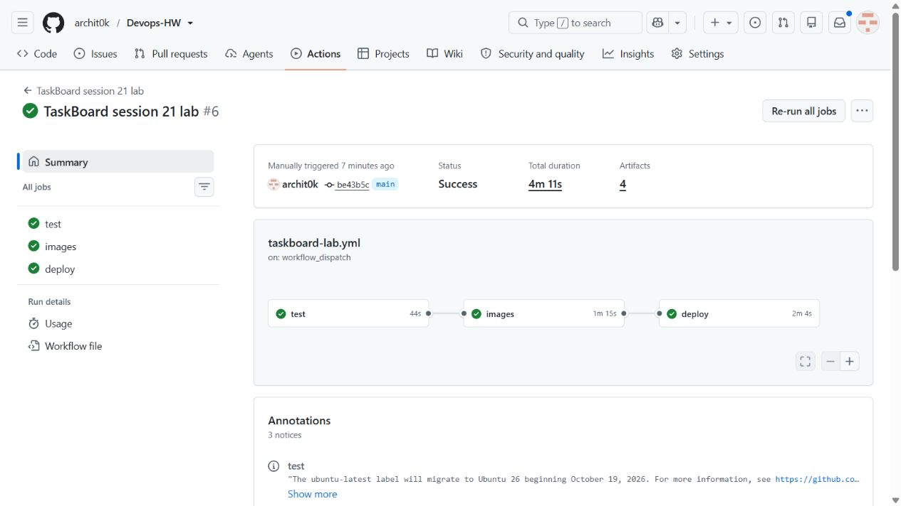
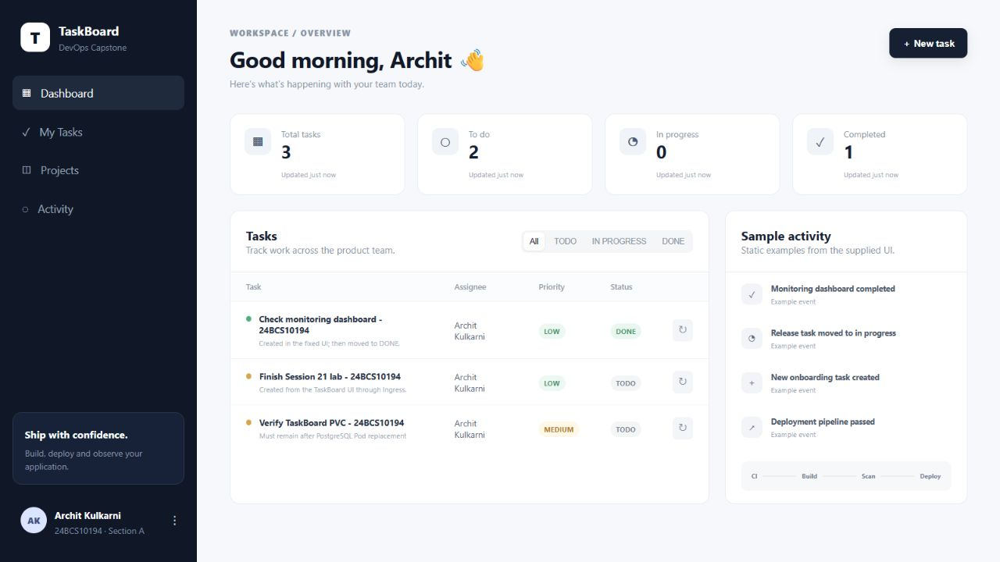
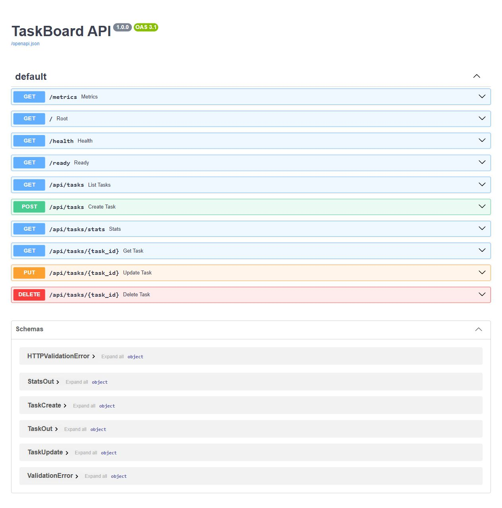
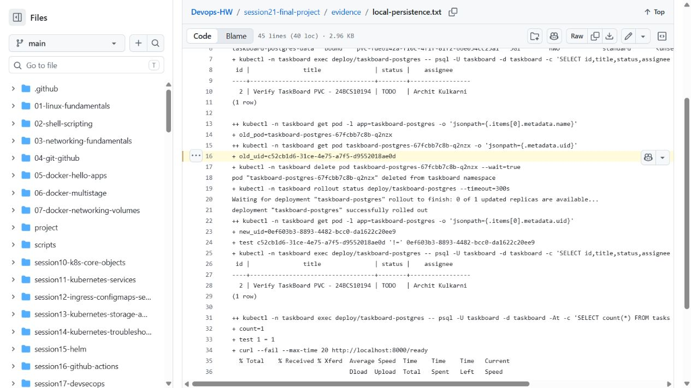
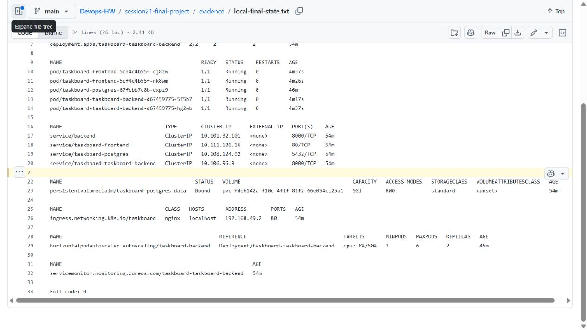
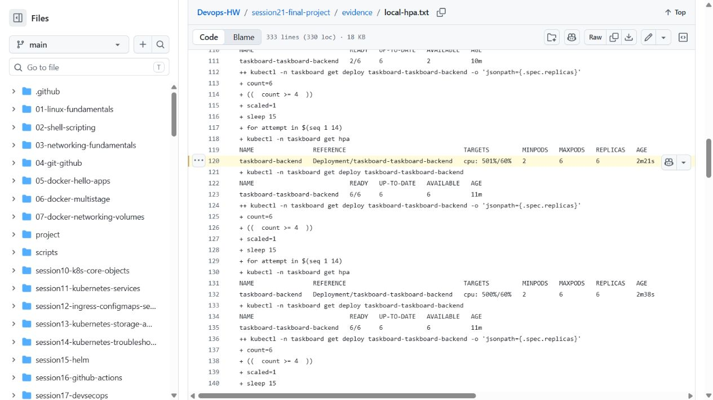
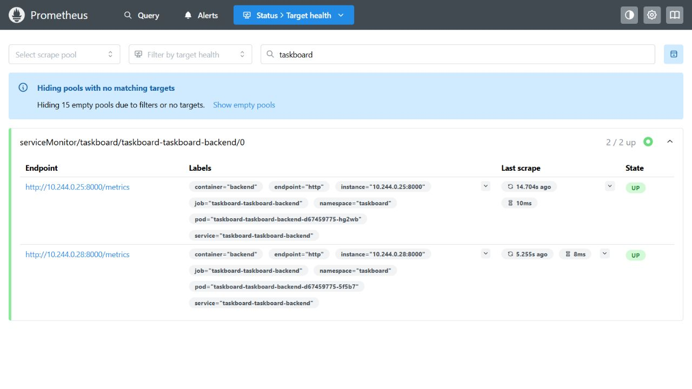
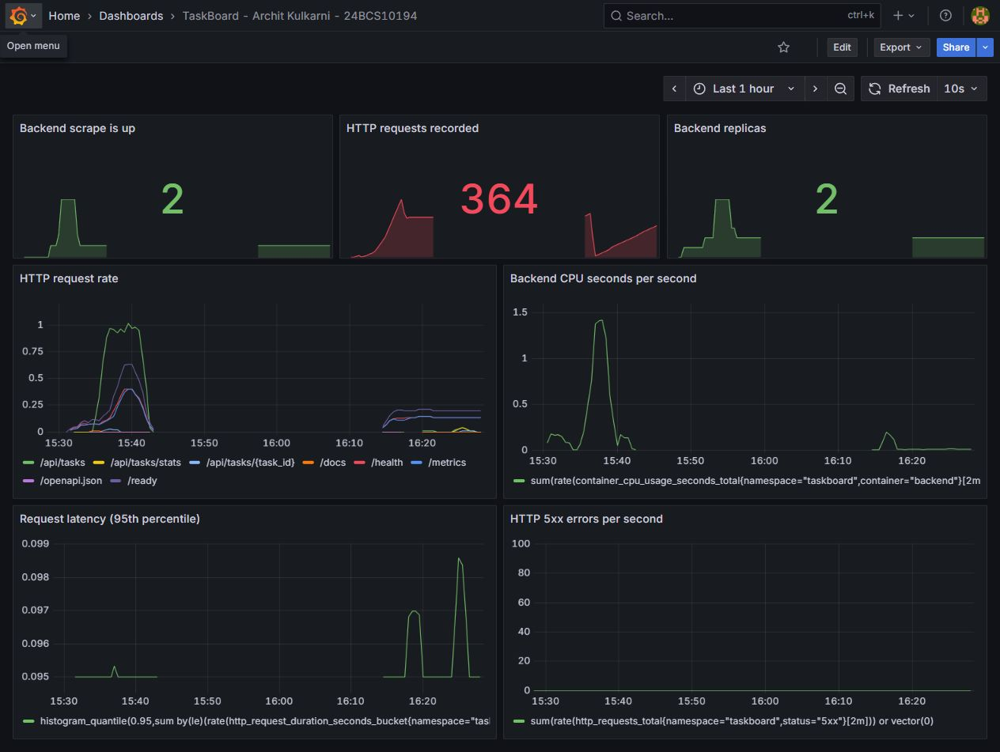
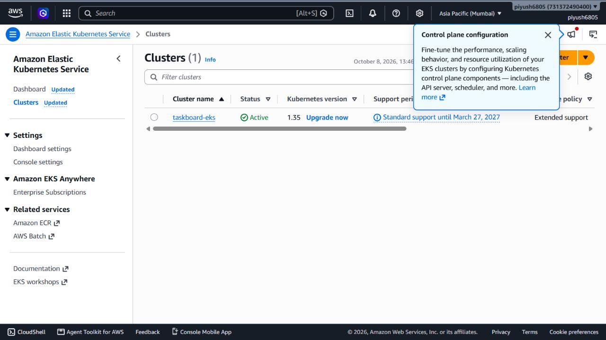

# Session 21 — TaskBoard walkthrough and troubleshooting

Archit Kulkarni | 24BCS10194 | Section A

TaskBoard uses React, FastAPI and PostgreSQL. This lab covers Compose, CI, Kubernetes, monitoring and troubleshooting.

[Source and command list](https://github.com/Nency-Ravaliya/devops-heros/blob/main/session21-python/README.md) · [Application files](taskboard/)

## Results

The [pipeline](https://github.com/archit0k/Devops-HW/actions/runs/37766328521) passed test, images and deploy on 8 October 2026. Application checks ran on Minikube and CI Kind. Terraform checks covered AWS infrastructure creation and cleanup.

| Part | Commands/checks | Result |
| --- | --- | --- |
| Compose | `docker compose up --build -d`, `ps`, health, ready, Swagger, metrics and CRUD | All services started on the runner; backend UID 10001; CRUD and database checks passed |
| Direct backend | Virtual environment, requirements, `alembic upgrade head`, Uvicorn | PostgreSQL-backed health/tasks/docs returned 200; task creation returned 201 |
| Tests/frontend | `pytest -q`, `npm ci`, `npm run build` | 3 tests and frontend production build passed |
| Git | Commit and push changes to the existing `main` branch | Pipeline ran against `be43b5c6c0a627713132ca8fab8e86318b4d17a4` |
| Images/security/registry | Build both Dockerfiles, Trivy HIGH/CRITICAL gate, GHCR push | Both scanned SHA-tagged images passed and were published |
| Terraform | `init`, `fmt`, `validate`, `plan`, `apply`, `destroy` | 66 AWS resources created, then all 66 destroyed; EKS 1.35 and two managed workers reached Active |
| Kubernetes/Helm | Namespace, runtime Secret, `helm upgrade --install`, Pods, Services and PVC | Kind deployment passed; local Minikube walkthrough also passed |
| Ingress | Frontend `/`, backend `/api`, browser task creation and status update | Requests routed through Nginx Ingress; task moved to DONE |
| Swagger | POST, GET by ID, PUT, DELETE | Responses 201, 200, 200 and 204; temporary task removed |
| Persistence | Query tasks, replace PostgreSQL Pod, query again | New Pod UID; same Bound 5 GiB PVC; task survived |
| HPA | CPU requests, Metrics Server, controlled load and recovery | Backend scaled 2 → 6 → 3 → 2; peak recorded CPU about 501% |
| Monitoring | ServiceMonitor, target health, PromQL and Grafana | 2/2 targets UP; recorded request count 452, p95 0.095 s and 5xx rate 0 |
| Troubleshooting | Apply broken image and Service, inspect, fix, retest | Both failure cases reproduced and repaired; details below |



## Files

| Path | Purpose |
| --- | --- |
| [taskboard/backend/](taskboard/backend/) | FastAPI, SQLAlchemy models, Alembic and tests |
| [taskboard/frontend/](taskboard/frontend/) | React interface, form handling and Nginx proxy |
| [taskboard/docker-compose.yml](taskboard/docker-compose.yml) | Local application and PostgreSQL stack |
| [taskboard/helm/taskboard/](taskboard/helm/taskboard/) | Deployments, Services, Ingress, HPA, probes and PVC |
| [taskboard/terraform/](taskboard/terraform/README.md) | AWS VPC/EKS configuration and access preflight |
| [taskboard/troubleshooting/](taskboard/troubleshooting/) | Broken image and Service examples |
| [taskboard-lab.yml](../.github/workflows/taskboard-lab.yml) | Test, scan, publish and isolated Kubernetes deployment |

## Compose and direct-backend commands

From the repository root on Linux/WSL, run the two helpers separately:

```bash
bash session21-final-project/run-compose.sh
bash session21-final-project/run-backend.sh
```

The Compose helper creates temporary credentials, checks API/database responses and stops its test stack. The direct-backend helper creates a virtual environment, uses a disposable PostgreSQL container on loopback port 15433, runs migrations and starts Uvicorn on 8000. Both need port 8000, so do not run them together.

To run Compose manually:

```bash
cd session21-final-project/taskboard
export POSTGRES_PASSWORD="$(openssl rand -hex 24)"
docker compose up --build -d
docker compose ps
curl http://localhost:8000/health
curl http://localhost:8000/ready
curl http://localhost:8000/api/tasks
docker compose down
```

The app is on `http://localhost:3000`; Swagger is on `http://localhost:8000/docs`. PostgreSQL uses host port 15432. `down` keeps the database volume; `down -v` deletes it.

For a direct backend setup, set a working PostgreSQL `DATABASE_URL`, then run `python -m venv .venv`, activate it, install `taskboard/backend/requirements.txt`, run `alembic upgrade head` and `uvicorn app.main:app --port 8000` from the backend directory. Readiness checks database access, while health checks the process.

## Application, API and database

TaskBoard exposes task list/create/read/update/delete, task statistics, `/health`, `/ready`, `/metrics` and `/docs`. The task table is PostgreSQL-backed. The activity sidebar is labelled as static sample UI content.





Swagger results: [POST 201](evidence/swagger-create.jpg), [GET 200](evidence/swagger-read.jpg), [PUT 200](evidence/swagger-update.jpg), [DELETE 204](evidence/swagger-delete.jpg).



## CI/CD, Docker and security

The workflow tests the backend, builds the frontend, checks Compose CRUD, builds both images, scans HIGH/CRITICAL vulnerabilities and publishes to GHCR. The deployment job loads the exact scanned images into a disposable Kind cluster, installs Helm and verifies a real task through the API before deleting the release and cluster.

The passing SHA-tagged pair is:

```text
ghcr.io/archit0k/taskboard-backend:be43b5c6c0a627713132ca8fab8e86318b4d17a4
ghcr.io/archit0k/taskboard-frontend:be43b5c6c0a627713132ca8fab8e86318b4d17a4
```

Local helper defaults: backend `09c8dec70b4652578823881ce4c51e73bfd945a4`, frontend `be43b5c6c0a627713132ca8fab8e86318b4d17a4`. The HPA/persistence run used `25ef8e537db59c165ce4e9fe8f6d4c2e1d4e787f`.

The frontend uses a Node build stage and Nginx runtime. The backend runs as a non-root user. Trivy blocks HIGH/CRITICAL findings before image publication.

## Kubernetes, Helm, Ingress and HPA

With Docker Engine, Minikube, kubectl, Helm and the images available, from the repository root:

```bash
bash session21-final-project/prepare-local-cluster.sh
bash session21-final-project/run-local.sh
bash session21-final-project/forward-local.sh
```

Leave forwarding running. In another shell:

```bash
python3 session21-final-project/check-api.py
bash session21-final-project/run-persistence.sh
bash session21-final-project/run-hpa.sh
python3 session21-final-project/generate-traffic.py
python3 session21-final-project/check-monitoring.py
bash session21-final-project/run-troubleshooting.sh
kubectl --context minikube get pods,svc,pvc,ingress,hpa -n taskboard
helm list -n taskboard
```

The chart uses a namespace, runtime database Secret, two application Deployments, stable Services, Nginx Ingress and PostgreSQL PVC. The frontend proxy reaches `backend:8000`; the chart includes that Service alias. Startup/readiness/liveness probes distinguish migration startup, database readiness and process health. A PostgreSQL Pod restart reuses its PVC. CPU requests and Metrics Server allow the HPA to calculate utilization and scale between 2 and 6 replicas.





## Prometheus and Grafana

Ports are loopback-only: application 3000, Swagger 8000, Prometheus 9090 and Grafana 3001. Grafana credentials are generated in a runtime Secret. The ServiceMonitor selects backend metrics; the dashboard shows traffic, request rate, p95 latency, 5xx rate, CPU and replica count.





Prometheus stores scraped time series; Grafana queries and plots them. These metrics support incident diagnosis, while application logs explain individual errors. Metrics Server, not Prometheus, supplies the HPA's CPU measurements in this setup.

## Troubleshooting

| Problem | Investigation and cause | Fix | Result |
| --- | --- | --- | --- |
| Broken image | `get pods`, `describe pod`, events: image tag unavailable | Correct image plus database configuration | Replacement Ready; `/ready` returned READY |
| Broken Service | Inspect selectors, labels, ports and endpoints: selector matched no Pods and target port was wrong | Select backend Pods; Service port 8080 → target port 8000 | Three endpoints; `/health` returned UP |
| Create-task modal failed | Handler used `e.currentTarget` after an awaited request | Save the form reference before `await`; handle non-success responses | Task creation/reset verified in the browser |
| PostgreSQL volume initialization | Volume root contained `lost+found` | Set `PGDATA` below the mount and use a single-writer rollout strategy | Database initialized and persistence check passed |

Saved command-output captures: broken image [before](evidence/troubleshooting-image-before.jpg) / [after](evidence/troubleshooting-image-after.jpg); broken Service [before](evidence/troubleshooting-service-before.jpg) / [after](evidence/troubleshooting-service-after.jpg).

## Terraform and cleanup

The [Terraform configuration](taskboard/terraform/README.md) uses providers, modules, variables, state, outputs and dependencies. It created the VPC, public/private networking, NAT, EKS and add-ons in `ap-south-1`: 66 resources created and 66 destroyed. Application deployment checks used Minikube and Kind; AWS checks covered infrastructure.



The access preflight requires a non-root Kubernetes principal before provisioning. Credentials, state and kubeconfig stay local.

For cleanup, [cleanup-local.sh](cleanup-local.sh) prints a SQL dump, removes TaskBoard/monitoring and the database PVC, then stops Minikube. Save the dump if needed and stop port forwarding with Ctrl+C. [stop-local-services.sh](stop-local-services.sh) also stops Docker/containerd; this affects every container using those services.

## Notes from the exercise

- Git commits identify the source used for each image; tests must pass before promotion.
- A Deployment replaces failed Pods, while a Service gives clients a stable address. Labels and ports still need separate checks.
- Helm values change an installed release without hand-editing every manifest; rollback restores a prior release revision.
- A PVC keeps data across Pod replacement. Deleting the claim can delete its volume.
- Check application requests, database persistence, routing and metrics after deployment.
