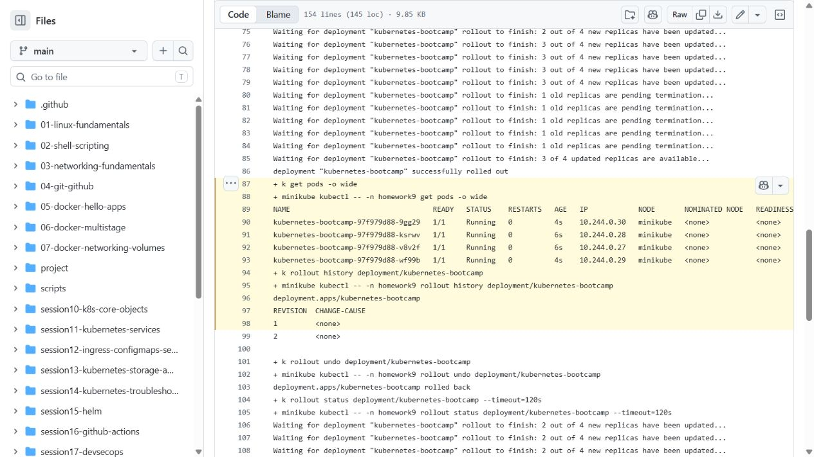

# Session 9 — Kubernetes fundamentals

Archit Kulkarni | 24BCS10194 | Section A

This lab covers cluster setup, the control plane, workload deployment, scaling, updates and rollback. [run-basics.sh](run-basics.sh) repeats the hands-on tutorial in a temporary namespace.

## 1. CLI and Minikube setup

This lab uses `kubectl` to talk to the cluster and Minikube to create the local control-plane node.

```bash
minikube version
minikube kubectl -- version --client --output=yaml
minikube start --driver=docker
minikube status
minikube kubectl -- get nodes -o wide
```

`minikube start` creates the cluster, `status` confirms host/kubelet/API-server health, and `stop` releases the VM resources without deleting cluster configuration.

## 2. Cluster architecture

```text
kubectl / controllers
        |
  kube-apiserver <--> etcd
        |
 scheduler + controller-manager
        |
     worker node
  kubelet -> container runtime -> Pods
  kube-proxy -> Service networking
```

The control plane stores cluster state in **etcd**. The **API server** is the entry point used by kubectl and controllers; the **scheduler** chooses a node for unscheduled Pods, and controllers reconcile desired state. On each worker, **kubelet** starts the assigned Pods through the container runtime, while **kube-proxy** handles Service traffic rules in this cluster.

## 3. Verification sequence

After the setup checks, run `bash run-basics.sh` from this folder. It deploys Nginx, exposes a Service, scales to four replicas, updates the image, checks rollout history, rolls back and requests the page from inside the cluster. The same Minikube cluster can be reused for later exercises.

## 4. Results

The local Minikube cluster was started with the Docker driver in Ubuntu WSL. The control plane and node check returned:

```text
Kubernetes control plane is running at https://127.0.0.1:32771
CoreDNS is running at https://127.0.0.1:32771/api/v1/namespaces/kube-system/services/kube-dns:dns/proxy

NAME       STATUS   ROLES           VERSION
minikube   Ready    control-plane   v1.37.0
```

The [full recheck](evidence/lab.txt), produced by [run-basics.sh](run-basics.sh), also deploys Nginx, exposes its Service, scales to four replicas, changes the image, checks rollout history, rolls back and verifies HTTP from inside the cluster. The temporary `homework9` namespace is then removed. WSL uses the Docker driver; `minikube kubectl --` keeps the CLI version matched to the cluster.



After finishing the local exercises, `minikube stop` stops the node without deleting its configuration.
